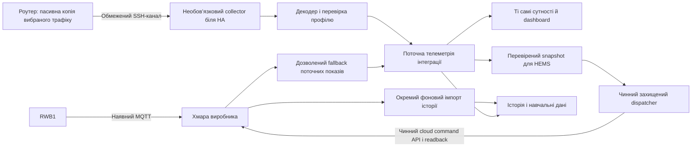

# Гібридна телеметрія: план реалізації для Hermes

Дата: 19.10.2026. Статус: дослідження й технічне завдання; цей документ не є звітом про готову функцію або реліз.

Це актуальний план для погодженого сценарію: незмінений Solar Plug-RWB1, необов’язковий пасивний collector через сумісний роутер, поточні покази локально, історія з хмари. Він має пріоритет над ранніми пошуковими варіантами перенаправлення MQTT у документах local-telemetry. Реалізацію Hermes починає після передачі цього завдання користувачем.

## 1. Результат для користувача

Звичайний користувач встановлює або оновлює інтеграцію як зараз: вводить хмарні облікові дані, отримує сутності та графіки. Немає вимоги мати OpenWrt, налаштовувати SSH, встановлювати collector чи вибирати протокол.

Власник сумісного RWB1 і роутера додатково відкриває «Налаштувати → Джерело даних → Гібридний режим». Майстер перевіряє обладнання, допомагає підключити collector, показує справжні контрольні покази й лише після успіху змінює джерело. Історія, назви сутностей, автоматизації та накопичене навчання зберігаються.

| Налаштування | Поточні покази | Історія | Додаткові вимоги |
| --- | --- | --- | --- |
| Хмара — початковий режим | Чинний cloud API | Чинний cloud API | Жодних нових |
| Гібридний режим | Підтверджені поля з collector | Cloud API у фоні | Сумісний роутер і collector |
| Гібридний, collector тимчасово недоступний | Хмара, якщо користувач дозволив fallback | Cloud API | Видиме повідомлення про перемикання |
| Гібридний без дозволу fallback | Відсутні локальні поля позначені недоступними | Cloud API, поки підключений | Без прихованого повернення до cloud telemetry |

Fallback стосується поточних показів. Його вимкнення не вимикає хмарну історію, чинне керування або з’єднання самого RWB1 із сервером виробника. У цьому релізі немає обіцянки автономної роботи без інтернету. Без сумісного роутера користувач продовжує нормально працювати через хмару; підтримка інших локальних транспортів є окремою майбутньою роботою.

## 2. Що підтверджено, а що ще ні

- У перевіреній базі `654a227` типовий цикл coordinator — 5 с, фонової історії — 900 с. Частий API-запит не доводить таку саму частоту нових фізичних вимірів.
- Пасивно знайдено MQTT-трафік RWB1 і CRC-valid Modbus responses різної довжини. П’ять полів одного 21-word блока збіглися з найближчим показом HA. Це кандидат профілю, а не повна доведена карта регістрів.
- Коротка Modbus response не містить початкової адреси регістра. Без зіставленого запиту або незалежно доведеного профілю її число не можна називати PV, мережею чи ватами.
- Частота кожного поля, повнота потоку, поведінка після reconnect і залежність від доступності cloud ще потребують вимірювання.
- У відокремленому worktree є незакомічений прототип `telemetry_sources/`, аналізатор capture і 47 цільових тестів, які проходили. Вони не підключені до production coordinator. Це не готовий collector, майстер або підтверджений повний runner.
- Деталі й виправлення помилкових припущень іншого агента: [аудит RWB1](rwb1-handover-audit-2026-10-19.md).

Перед роботою Hermes звіряє актуальний develop, worktree і вже внесені паралельні зміни. Не переносить стару копію coordinator поверх нової. Невідомий профіль залишається діагностичним і не стає джерелом керування.

## 3. Архітектура

Роутер копіює лише трафік потрібного адаптера. Не підміняємо ARP, DNS, шлюз або MQTT-сервер; не посилаємо невідомих команд RWB1. Важке декодування, черги та довготривале зберігання виконуються біля HA, а не у flash роутера.

Рекомендована упаковка collector: необов’язковий HA App для HA OS і той самий сервіс як контейнер для HA Container. Обрати один формат внутрішнього повідомлення й одну реалізацію collector. Не запускати необмежений root SSH subprocess у циклі coordinator. HA Apps доступні лише на HA OS: [офіційний опис](https://www.home-assistant.io/apps/).

Collector доставляє нормалізовані повідомлення через автентифікований локальний канал; практичний кандидат — наявна MQTT integration з окремими ACL і простором тем. На етапі прототипу перевірити, чи можна повторно використати налаштований брокер без дублювання паролів. Якщо ні — майстер чесно показує окремий крок підключення; звичайний cloud setup від цього не залежить. Не створювати другий комплект сутностей через MQTT discovery.

Відокремити три стани: доступність локальної телеметрії, доступність cloud history, доступність cloud command/readback. Один прапорець `last_update_success` не повинен помилково означати справність усіх трьох каналів.

## 4. Майстер налаштування

1. **Вибір режиму.** «Хмара» та «Гібридний через сумісний роутер». Пояснення переваг, обмежень і вимоги до роутера одним коротким абзацом. Поточне налаштування збережене до завершення майстра.
2. **Collector.** Знайти лише реально підтримуваний сервіс або запропонувати встановлення App/контейнера відповідно до типу HA. Автовиявлення не вигадувати; за його відсутності дозволити явну адресу.
3. **Роутер.** Адреса, перевірка SSH host key, сумісності capture, інтерфейсу й маршруту адаптера. Разовий адміністративний доступ використовується для встановлення окремого обмеженого сервісного доступу. Показати перелік власних змін і спосіб видалення. Не вимикати offloading або інші функції мовчки.
4. **Інвертор.** Зіставити з наявним config entry за стабільною ідентичністю; IP лише адреса доступу. Показати підтверджений профіль і список перевірених полів. Не приймати трафік іншого інвертора за цей пристрій.
5. **Пробне читання.** Показати SOC, PV, навантаження та інші доступні поля, час отримання і виміряний інтервал надходження. Непідтверджені поля явно перелічити. Не вимагати від користувача вручну шукати регістри або вводити SOC.
6. **Завершення.** Явний перемикач «При втраті локальних показів тимчасово використовувати хмару». Підсумок: «Поточні покази — локально; історія — хмара». Застосувати options атомарно; помилка повертає до попереднього робочого режиму.

Сервісний ключ обмежений фіксованою командою capture, потрібним пристроєм і транспортом; без довільних команд, forwarding, PTY та повного shell. Реальну підтримку обмежень Dropbear/OpenSSH перевірити для підтримуваних версій. Якщо мінімальні права не забезпечені — не називати таку установку готовою для звичайного користувача. Паролі/ключі не потрапляють у діагностику, журнали, Git або URL.

Після setup: одна сторінка стану, кнопки «Перевірити», «Повторно підключити», «Повернутися до хмари». Розширені параметри приховані. Від’єднання видаляє тільки власні компоненти, не SSH-доступ користувача і не Mosquitto інших інтеграцій.

## 5. Дані, частота й цілісність

| Група | Правило |
| --- | --- |
| Поточні потужності, SOC, напруги | Локальні лише після підтвердження mapping, одиниць, знака і профілю; інакше дозволена хмара або невідомо |
| Час | Окремо receipt time, measurement time якщо відомий, origin, quality, age; невідомий measurement time не підміняти receipt time |
| Snapshot для керування | Потрібні достатні свіжі поля з прийнятним часовим розкидом; не складати удаваний миттєвий баланс із різновікових значень |
| Енергетичні лічильники | Зберегти семантику накопичувального counter; падіння при перемиканні джерела не повинно створити фальшивий reset і зайві кВт·год |
| Інтеграл потужності | Окрема оцінка з coverage і пропусками; не додавати до cloud counter за той самий інтервал |
| Історія | Ідемпотентний ключ пристрій + метрика + UTC-інтервал + версія; джерела мають явний пріоритет і походження |
| Прогнози | Зафіксований прогноз не переписується фактом, новим джерелом або новою моделлю |
| Керування | Чинний dispatcher і підтвердження; локальний показ не є автоматично підтвердженням ACK cloud-команди |

Нуль — валідний вимір; відсутність — не нуль. Передбачити signed значення та напрямки заряду/розряду. Зміна transport не змінює ідентичність місцевості/інвертора і не очищує журнали калібрування.

Push-дані оновлюють стан інтеграції при надходженні перевіреного snapshot; історія працює незалежним фоновим завданням. Спочатку зберегти наявний інтервал історії 900 с. Частий push не повинен нескінченно відкладати історію через скидання poll-таймера coordinator. Механізм push описаний у [HA Fetching data](https://contributors.home-assistant.io/core/integrations/fetching-data/).

Не збільшувати частоту cloud API «для швидкості». Після стабільного local setup можна зменшити зайві cloud realtime reads, зберігши необхідні auth, конфігураційні читання та readback. Окремо обмежити частоту оцінювання HEMS: кожен пакет не повинен запускати фізичну команду.

Collector: TCP reassembly за повним connection tuple і послідовністю байтів; MQTT Remaining Length, фрагментація, кілька повідомлень у сегменті, retransmission, reconnect, дублікати й порядок. Обмежені буфери/черги, контроль відставання та відновлення. Не рахувати повтор пакета як новий вимір. Немає постійного сирого capture за замовчуванням.

## 6. Історія і навчання

Cloud history корисна як початкова історія та джерело фактів за пропущені інтервали. Вона не відновить секундні деталі, яких сервер ніколи не зберігав. Завантажувати частинами, з кешем, обмеженням запитів і повторенням від останнього успішного checkpoint. Втрата cloud history не зупиняє свіжі локальні покази.

Відокремити: HA Recorder, довгострокову статистику, внутрішню погодинну/денну історію моделей та журнал прогноз–факт. У Recorder типовий строк сирої історії — 10 днів; `commit_interval` визначає запис у БД, а не частоту живого показу UI. Не збільшувати загальну retention HA і не писати напряму в його БД заради цієї функції. [Recorder](https://www.home-assistant.io/integrations/recorder/).

Для моделей потрібне власне стале сховище придатних інтервалів, coverage і версій. Узгодити обсяг після вимірювання розміру даних; не очищувати вже наявні журнали. Сирі мережеві пакети для навчання не потрібні. У першій версії не обіцяти backfill нативної Energy-панелі лише від наявності cloud history.

Раніше імпортовані факти можна використовувати для аналізу споживання й агрегатів, але вони не стають новими незалежними перспективними прогнозами. Тисячі вимірів за день не замінюють десятки завершених днів forecast–actual. Зміна джерела сама по собі не підвищує confidence.

## 7. Вимірюваний ефект

| Показник | Очікуваний ефект | Як довести |
| --- | --- | --- |
| Затримка показу | Може знизитися через обхід cloud API для поточного стану | Час capture → прийом HA; зіставлення того самого повідомлення з хмарою, де можливо |
| Частота нових вимірів | Може зрости відносно cloud API, лише якщо RWB1 вже передає їх частіше | Медіана/p95 інтервалів кожного поля, не кількість API polls або дублів |
| Фізична точність датчика | Автоматично не змінюється | Окрема перевірка еталоном, якщо потрібна |
| Якість даних | Може зрости завдяки меншій затримці, кращій coverage і перевіркам | Частка валідних інтервалів, пропуски, суперечливі знаки/баланси, контроль одиниць |
| Енергія й тарифи | Потенційно точніша інтеграція коротких змін | Порівняння добових інтегралів із надійним лічильником; окремо похибка й coverage |
| Планування батареї | Свіжіший стан допомагає, але помилки planner залишаються окремими дефектами | Replay однакових сценаріїв, енергобаланс, дефіцит, обмеження та своєчасність |
| Прогноз PV і споживання | Кращі факти можуть допомогти навчанню; гарантованого приросту немає | Незалежна перевірка по майбутніх днях, MAE/зміщення проти базового прогнозу |

Не обіцяти 1–5 с, поки не виміряний сам потік. Початкова інженерна ціль доставки collector → HA: p95 не більше 1 с у нормальній LAN; це бюджет транспорту, не заява про частоту фізичного вимірювання. Якщо пакет не має measurement timestamp, фізичний вік даних залишається невідомим.

Для прогнозів: rolling-origin оцінювання без майбутніх фактів у навчанні; окремо PV і load, день/ніч, coverage, версії моделі й майданчика. Не виводити відсоткову помилку діленням на майже нульову генерацію. Спочатку перевірити накопичення завершених пар і незмінність snapshot, потім змінювати модель. Погоду, орієнтацію панелей і апаратні межі телеметрія сама не виправляє.

## 8. Послідовність реалізації

| Етап | Робота Hermes | Критерій завершення |
| --- | --- | --- |
| A. База та профіль | Звірити актуальний код; 30 хв пасивного capture, потім 24 год canary; перевірити поля, знак, одиниці, інтервали, дублікати, reconnect | Таблиця підтримуваних полів і фактичної cadence; непідтверджені поля виключені |
| B. Collector | Реалізувати обмежений capture, reassembly, decoder, reconnect і доставку; одна App/container реалізація | Стримінг із контрольованими ресурсами й тестами на втрати/фрагментацію; cloud-трафік адаптера не змінений |
| C. Інтеграція джерел | Підключити перевірений provider до runtime; freshness/coherence, fallback, окреме здоров’я каналів | Ті самі сутності й статистика, cloud-only upgrade без змін; збої одного каналу не ламають інші |
| D. Майстер і діагностика | Options flow, установка/перевірка collector, пробне читання, атомарне застосування, просте повернення | Новий користувач проходить setup без ручного редагування YAML/SSH-команд; cloud-користувач не бачить обов’язкових нових кроків |
| E. Гібридна історія | Окремий scheduler, checkpoint/dedup, походження фактів, coverage і збереження навчальних журналів | Reload, пропуски, DST і зміна джерела не гублять/не подвоюють енергію й forecast pairs |
| F. Доказ ефекту | Порівняти local/cloud cadence, delivery latency, coverage; перевірити дані для ШІ | Виміряна таблиця до/після; точність прогнозу оцінена окремо або явно ще очікує нових днів |
| G. Приймання і випуск | Цільові regression, повний runner на фінальному коді, авторизований browser, документація сумісності, backup/rollout | Чесний статус усіх перевірок; pilot успішний; готовий конкретний релізний пакет |

A — обов’язкова передумова реклами швидкості та активації неперевірених полів. Незалежні B/D/E можна готувати до завершення 24-годинного спостереження, не називаючи transport доведеним. Якщо cadence не краща за cloud, завершити перевірні частини і повідомити результат, а не вигадувати покращення.

Реалізацію робити невеликими reviewable комітами. Перед випуском звірити паралельні зміни Hermes, зберегти UI та наявні режими. Реліз і live rollout — окремий фінальний крок після перевірок, не наслідок самого написання цього плану. Потрібний для встановлення restart обґрунтувати й повідомити; не перезапускати Core заради кожної frontend правки.

## 9. Обов’язкові поведінкові перевірки

- Нова установка та upgrade без telemetry options: cloud працює, SSH/collector не запускається, немає нових обов’язкових залежностей.
- Невдалий/перерваний майстер не змінює робочі options; повторне налаштування не дублює сутності, collector або ключі.
- Collector/router/HA reload і reconnect; інший DHCP IP того самого адаптера; інший адаптер на старому IP; кілька інверторів.
- Втрата local із дозволеним/забороненим fallback; частково відсутні поля; прострочені або різновікові поля; нуль, негативний струм, невідома одиниця.
- Cloud token прострочений при справному local: покази залишаються, history/command показують окремий збій; немає фальшивого readback success.
- Packet split/coalescing/retransmit, TCP reconnect і MQTT malformed/oversize: обмежені ресурси, відсутні дублікати й секрети у логах.
- Перемикання джерел, reset counter, пропуск доби, Europe/Kyiv DST, backfill після reload: немає зайвих кВт·год, дублів або очищення калібрування.
- Історичний імпорт не переписує forecast snapshot, не ретегує моделі та не підвищує sample count неправдивими парами.
- HEMS отримує лише придатний coherent snapshot; новий пакет не обходить pause, breaker, pending confirmation або ручні налаштування.
- Авторизований browser: реальний dashboard на вузькому й широкому екрані, майстер, fallback, reauth, незмінність форм і зрозумілі повідомлення. HTTP 200 на сторінці входу не є прийманням.

## 10. Межі приймання й відповідь Hermes

Live Adaptive / Shadow / outage observation зберегти. Automatic не вмикати і фізичних тестових команд не надсилати. Ручні планові відключення залишаються чинним сценарієм; Telegram/IMAP, нове обладнання і зміни прошивки RWB1 не входять до цього завдання.

Звіт Hermes має містити: commit і перевірену базу; реалізовані компоненти; простий шлях користувача; реальну підтримку обладнання; cadence/latency/coverage по полях; поведінку відмов; збережені entity IDs/історію/моделі; точний результат тестів; що перевірено live, а що лише fixtures; відкриті обмеження. Наявність символу в `.py`, `.pyc` або зелений poll не доводять працездатність повного шляху.

Короткий текст для передачі: «Реалізуй погоджений гібридний режим за цим планом: cloud за замовчуванням; opt-in пасивний RWB1 collector через сумісний роутер; локальні поточні покази та окрема cloud history. Почни з доказу профілю й cadence. Не змінюй трафік адаптера, наявні режими, entity IDs і навчальні журнали. Заверши майстер, відмовостійкість і поведінкові докази; не обіцяй частоту або точність, яких не виміряв. Якщо бракує конкретного доступу, назви його після виконання незалежних частин». 
