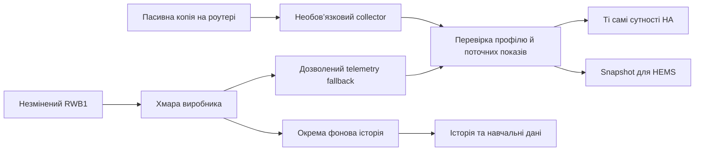

# Архітектура локальної телеметрії для Smart Solar Inverter

Уточнення scope 19.10.2026: див. [актуальний план гібридного режиму для Hermes](hybrid-telemetry-hermes-implementation-plan-2026-10-19.md). Поточний випуск — cloud за замовчуванням, opt-in пасивний RWB1 collector через сумісний роутер та окрема cloud history. Нижче збережено також попередні дослідницькі варіанти; вони не є вимогами цього випуску. Без сумісного роутера працює чинна хмара.

Дата: 19 жовтня 2026 року. Стан: архітектура; спільний контракт даних, адаптер наявного cloud payload, HA-entity provider, transport-neutral source router і суворі експериментальні декодери реалізовані ізольовано. Нові джерела ще не підключені до coordinator або live-плагіна.

Порядок робіт і критерії готовності: [план реалізації локальної телеметрії](local-telemetry-implementation-plan.md). Реалізація розпочата у відокремленому worktree; live telemetry ще не перемикали.

Погоджений користувачем спосіб для поточного комплекту — RWB1 без змін, read-only collector на OpenWrt та decoder/source provider біля HA. Для продукту це окремий opt-in. Звичайні й оновлені установки без цієї конфігурації запускаються через чинну хмару без router discovery, SSH і залежності від collector. Перехід джерела зберігає config entry/entity IDs та історію. UI показує фактичне джерело і freshness; робота через локальну копію cloud MQTT не називається автономною роботою без інтернету.

Налаштування collector має виконувати окремий майстер: адреса/перевірка сумісного роутера, разова авторизація, конкретний перелік змін і відновлення, перевірка пристрою/профілю та контрольних readings, явний cloud fallback. Головний пароль роутера не повинен ставати постійною залежністю config entry; сервісний доступ має бути окремим і обмеженим до функції захвату. Будь-яка невдача додаткового setup лишає чинний cloud-шлях робочим. Непідтримувані роутери не вимагають ручного налаштування від звичайних користувачів плагіна.

Мета — один плагін із простим майстром налаштування, який отримує дані з доступного користувачеві каналу. OpenWrt, окремий MQTT-брокер, NAS і cloud account не повинні бути загальними вимогами всіх локальних підключень. Конкретний спосіб усе одно потребує відповідного інтерфейсу інвертора або адаптера.

## Межі плагіна і мережевого компонента

У плагіні залишаються налаштування, підтримка моделей, декодування й перевірка даних, вибір джерела, діагностика, наявні сутності HA, графіки, історія, ШІ та планувальники. Прямі LAN, Bluetooth і USB-підключення можуть працювати всередині інтеграції, якщо протокол підтримується й HA має доступ до потрібного інтерфейсу.

Для наявного RWB1 перевірено вихідне MQTT-з’єднання з хмарою та пасивний 21-word Modbus-кадр. В одному 120-секундному захопленні little-endian трактування всіх п’яти зіставлених полів повністю збіглося з live HA. Два санітизованих спостереження побачили JSON PUBLISH, але жодного Modbus-кадру; одне вікно збігалося з готовністю користувача оновити застосунок, однак причинний зв’язок і свіжість значень не встановлені. Кілька типових TCP-портів перевірено; лише HTTP/80 доступний, а документований generic TCP/IP serial mode не встановлено на цьому пристрої. Живий сервіс телеметрії ще не підключено, а частоту кадрів не встановлено. Звичайна інтеграція HA не отримує автоматично трафік між іншим LAN-пристроєм і його хмарою.

Прозорий MQTT-міст технічно можна вбудувати в Python-код інтеграції, але це не усуває потреби направити до нього трафік адаптера. Для такого мосту пропонується окремий необов’язковий сервіс: його перезапуск і відновлення можна відокремити від HA Core. Він залишається частиною того самого продукту та керованого сценарію встановлення.

Для HA OS сервіс можна постачати як Home Assistant App; для Home Assistant Container — як окремий контейнер. [HA Apps](https://www.home-assistant.io/apps) доступні лише для HA OS, тому App не може бути єдиним способом встановлення всього продукту.

## Варіанти для користувачів

Пізніше уточнення 19.10.2026: виправлений аналізатор у router capture знайшов outgoing MQTT PUBLISH із CRC-valid блоками на 1/8/21/29 words і incoming PUBLISH. Отже, попередня відсутність знайдених frames у коротких captures не виключає короткі Modbus responses; стабільна каденція, mapping усіх blocks і робота без cloud усе ще не підтверджені. Див. [аудит handover](rwb1-handover-audit-2026-10-19.md).

| Спосіб | Що потрібно | OpenWrt | Стан підтримки |
| --- | --- | --- | --- |
| Поточна хмара | Обліковий запис виробника та інтернет | Не потрібний | Наявний спосіб; швидкість нових вимірів обмежена джерелом |
| Прямий USB/RS232 | Сумісний кабель, доступний порт інвертора, доступ HA до USB | Не потрібний | Документований апаратний шлях для POW-HVM6.2M-48V-N; драйвер і конкретну прошивку потрібно перевірити |
| ESP32 RS232→MQTT/HA | ESP32 із RS232-трансивером, інтеграція Home Assistant/MQTT; RWB1 замінюється | Не потрібний | Solar2MQTT має користувацькі повідомлення про успішну роботу цієї моделі; частоту й наш конкретний екземпляр ще не перевірено |
| Прямий локальний LAN | Адаптер із підтримуваним локальним API/протоколом | Не потрібний | Майбутні профілі сумісності; відкритий API саме нашого RWB1 поки не підтверджено |
| Bluetooth | Підтримуваний BLE-протокол і приймач поблизу | Не потрібний | RWB1 має BLE; протокол телеметрії та стабільність роботи в HA ще потрібно дослідити |
| RWB1 із налаштованою адресою локального сервера | Прошивка, що дозволяє змінити адресу сервера, та локальний міст | Не потрібний | Можливість зміни сервера в цій прошивці не перевірена; це перший кандидат для спрощення RWB1-підключення |
| RWB1 зі збереженням наявної адреси хмари | Локальний міст і перенаправлення його вихідного трафіку | Потрібен роутер із відповідною функцією; OpenWrt — перевірюваний варіант | На поточному комплекті є один кадр, що збігся з п’ятьма показами HA; частота та кероване читання не підтверджені |
| Окремий готовий мережевий або послідовний шлюз | Підтримуваний шлюз біля інвертора | Основний роутер можна зберегти | Резервний варіант, коли наявні інтерфейси недоступні; потрібні власні перевірки обладнання |

Для точної моделі користувача [SolarAssistant документує RS232/COM](https://solar-assistant.io/help/inverters/powmr/POW-HVM6.2M-48V-N/rs232). [Solar2MQTT](https://github.com/softwarecrash/Solar2MQTT) має MQTT/HA-підтримку та community reports про роботу POW-HVM6.2M-48V-N через RS232. Це практичний шлях без спеціального роутера, але не означає, що можна одночасно підключити два активні master до одного порту. Сумісність кабелю, електричні рівні й протокол мають пройти перевірку на конкретному екземплярі.

BLE-підтримку слід будувати через [Bluetooth API Home Assistant](https://www.home-assistant.io/integrations/bluetooth), з використанням наявних приймачів або сумісного проксі. Підтримка активних BLE-з’єднань залежить від проксі; наявність будь-якого Bluetooth-пристрою не гарантує доступ до GATT інвертора. Наявність BLE в RWB1 не є доказом готового HA-драйвера.

## Готова схема даних

У прототипі `telemetry_sources.cloud.cloud_payload_to_frame` нормалізує п’ять чинних cloud API readings у спільний кадр без додаткового запиту. Невідомі/невалідні значення не перетворюються на нулі; `received_at` задається викликачем окремо від фізичного `measured_at`, який лишається невідомим. `telemetry_sources.router.TelemetrySourceRouter` збирає кадри від налаштованих read-only providers, ізолює помилки кожного provider (у діагностиці лишає лише його ID і тип помилки), а потім застосовує політики свіжості/якості по кожному полю. Він не змінює сутності й не виконує команд інвертора. Provider має сам установлювати мережевий deadline; coordinator і live config flow ще не використовують router.

Для поточного RWB1 обрано копіювання трафіку без зміни сервера, маршруту або прошивки. Гілки прямого доступу й перенаправлення з раннього дослідження не входять до цього випуску. Саме копіювання не збільшує частоту опитування інвертора адаптером і не доводить роботу без хмари.

## Єдиний майстер налаштування

Використовуємо [Config Flow Home Assistant](https://contributors.home-assistant.io/core/integrations/config-flow/) та Options Flow наявної інтеграції.

1. Користувач обирає «Швидке локальне підключення» або поточну хмару. Для наявної установки змінюється джерело всередині того самого пристрою.
2. Плагін показує знайдені сумісні пристрої й доступні інтерфейси. Якщо автоматичний пошук не підтримується, користувач задає адресу або вибирає USB-порт. Модель і прошивка звіряються з профілями.
3. Плагін читає контрольну порцію даних і показує SOC, PV, навантаження та інтервал отримання відповідей. Невідомі значення залишаються невідомими.
4. Лише якщо обраний спосіб потребує сервісу мосту, майстер пояснює його встановлення для HA OS або Container. Основний інтерфейс налаштування даних залишається в плагіні.
5. Для поточного RWB1 встановлюється лише пасивний capture із перевіреним обмеженим доступом; майстер показує власні зміни та спосіб їх видалення. Непідтримуваний роутер не заважає продовжувати роботу через хмару.
6. Після перевірки зберігається джерело. Наявні сутності, історія, HEMS та користувацькі картки продовжують використовувати той самий пристрій.

Базові сценарії повинні налаштовуватися без YAML, токенів у терміналі, ручного hex-вводу й самостійного вибору регістрів. Якщо потрібні спеціальні апаратні дії, майстер показує їх лише для обраного способу.

Нинішній вхід у плагін починається з cloud email/password. Гібридний режим налаштовується в наявному config entry; це не новий cloud-free onboarding. Доступність локальних показів, cloud history та cloud command/readback відстежується окремо. Локальне читання саме по собі не створює канал запису команд.

У діагностиці видно активне джерело, останнє приймання даних, відсутність/наявність часової мітки пристрою, причину fallback і підтримувані поля. У звичайній картці достатньо зрозумілих станів «Локальне підключення», «Хмара», «Дані застаріли» та фактичного інтервалу отримання відповідей.

## Внутрішні компоненти

| Компонент | Відповідальність |
| --- | --- |
| Спільна бібліотека протоколів | Формат пакетів, CRC, модель/прошивка, карта регістрів і одиниці; без залежності від конкретної адреси або роутера |
| Джерела телеметрії | Cloud, підтримуваний LAN, Serial, BLE, Gateway; асинхронне читання/приймання та завершення при unload |
| Валідація спостережень | Джерело, час отримання, час виміру або unknown, якість кожного поля, пропуски й повтори |
| Вибір джерела | Явний пріоритет, оцінка доступності, контрольоване відновлення та позначення fallback |
| Coordinator | Дані для наявних сенсорів, історії, ШІ та HEMS через один погоджений контракт |
| Необов’язковий сервіс мосту | Довгі TCP/MQTT-сесії та ізольований локальний listener для відповідного обладнання |
| Майстер і діагностика | Виявлення можливостей, перевірка перед збереженням, зрозумілі помилки та міграція наявної установки |

Межа між бібліотекою та інтеграцією дозволяє використовувати той самий декодер у HA, App і контейнері. Декодер не має містити адресу `<RWB1-IP>`, серійні номери власника, адресу його брокера чи ключ роутера.

Ідентичність інвертора відділяється від адреси транспорту. Зміна IP, USB-порту або адаптера не створює нового набору сутностей для того самого наявного пристрою. Установки з кількома інверторами ізолюють потоки, карти регістрів і credentials для кожного пристрою.

## Правила переходу між джерелами

- Локальний канал і хмарний можуть підтримувати різні поля. Наприклад, локальні потужності та хмарні добові лічильники зберігають власне походження; вони не оголошуються одним одночасним виміром.
- У разі втрати локального каналу fallback використовує тільки придатні дані й явно змінює позначення джерела. Кеш або недавня HTTP-відповідь не стають доказом нового виміру інвертора.
- Перехід між каналами не подвоює енергетичні лічильники й навчальні вибірки. Інтегрування потужності враховує реальний час і розриви.
- Відкритий reference для PowMr M-series описує запит 4501/45 кожні кілька секунд і включає HVM6.2M-48V як очікувано сумісну модель, але саме цей екземпляр не позначено як протестований. Це кандидат для контрольної перевірки, не гарантована частота.
- На нашому RWB1 пасивне спостереження дало один відповідний кадр у 120-секундному вікні, а два наступні вікна (180 і 120 секунд) — без кадрів. Тому наразі не заявляється ані 2-секундне, ані інше гарантоване оновлення. Час фізичного виміру залишається невідомим, якщо пристрій його не повідомляє.
- Дані для планувальника агрегуються з контрольованим часовим кроком: частіше опитування не повинно штучно піднімати confidence або змінювати вагу навчання.

Зміна джерела телеметрії не переносить автоматично команди керування на новий транспорт. Початкова локальна реалізація лише читає дані; наявний захищений dispatcher, ручні паузи й перевірки доставки зберігаються. Можливість локального керування — окрема перевірювана функція.

Якщо встановлено лише локальний моніторинг без підтримуваного каналу команд, керування показує конкретну причину недоступності. Новий SOC або PV-кадр не є підтвердженням виконання раніше відправленої команди: readback перевіряє саме потрібне налаштування й відповідність команді.

## Порядок реалізації

| Етап | Дія | Умова завершення |
| --- | --- | --- |
| 0A | Спільний контракт джерела, профіль моделі та збереження ідентичності | Джерело можна замінити без перейменування сутностей і без перенесення команд керування |
| 0B | Перевірити локальний Wi-Fi/LAN RWB1 з наявним обладнанням | Виявлено доступний транспорт і стабільно декодовані покази; жодних змін налаштувань/записів в інвертор |
| 0C | Прототип read-only локального джерела RWB1 для наявної установки | HA або його штатний Bluetooth шлях читає джерело; freshness, одиниці, походження й fallback перевірені |
| 0D | Прямий Serial для підтримуваної M-серії та майстер (майбутній необов’язковий шлях) | Сценарій без OpenWrt і окремого сервісу перевірений на реальному обладнанні; RWB1 від’єднаний, якщо порт один |
| 0E | Упаковка мосту для HA OS і Container, майстер та документація | Чисте встановлення в обох середовищах, перевірка оновлення/відмови/видалення |
| 0F | Випуск локального підключення для інших користувачів | Таблиця сумісності, виміряна частота, відомі обмеження й відтворюваний сценарій налаштування |

Для поточного власника 0B/0C обмежені наявним RWB1 та його мобільним застосунком; додатковий шлюз, ESP32 чи RS232 адаптер не є передумовою досліду. Bluetooth-адаптера для HA зараз немає, тому перший маршрут — Wi-Fi/LAN; BLE залишається необов’язковим наступним кандидатом. Якщо штатний HA host не має доступного Bluetooth і RWB1 не відкриває телеметрію локально по Wi-Fi, BLE шлях може вимагати окремого проксі — у такому разі це буде чітко вказана вимога, а не приховане припущення. Загальнодоступний випуск із заявленою підтримкою користувачів без OpenWrt має містити хоча б один реально перевірений та реалізований спосіб без нього. LAN/BLE-профілі не потрапляють у список підтримуваних до такої перевірки.

Бібліотека, плагін і додатковий сервіс постачають сумісні версії. Для мосту фіксуються ревізія протоколу, границі прав, очищені журнали й перевірки чужої адреси пристрою, неправильного регістра, CRC, паралельних читань та відновлення зв’язку.

## Що підтверджено зараз

На комплекті власника підтверджені MQTT-транспорт RWB1, CRC-валідні Modbus-кадри та збіг п’яти декодованих полів із HA. Один відкритий PowMr serial reference перелічує точну модель HVM6.2M-48V як імовірно сумісну й описує read запит 4501/45, але не вказує її серед прямо протестованих. У `telemetry_sources` є транспортно-незалежні типи зі сталим ID пристрою, окремими часами отримання/виміру, якістю полів і вибором джерела для кожного поля. Експериментальні декодери не відкривають мережевих з’єднань і не надсилають запитів.

Цей прототип ще не доводить адресу регістра у відповіді нашого адаптера: пасивно спостережена відповідь не містила початкової адреси. Прототип не інтегрований у coordinator, не змінює сутності чи історію, і не прискорює live-оновлення. Частота 2–5 секунд, зміна серверної адреси, BLE-телеметрія й новий майстер ще не перевірені або не реалізовані. Для поточного власника перший кандидат — BLE або локальний Wi-Fi RWB1, бо це єдине наявне обладнання. Прямий serial лишається майбутнім альтернативним кандидатом для користувачів з потрібним інтерфейсом; його сумісність і частота мають бути підтверджені контрольованим читанням, а не лише чужою таблицею сумісності. Детальні спостереження та загальний порядок покращення ШІ наведені в [основному плані](telemetry-ai-roadmap-2026-10-19.md).

Референс для RWB1-мосту: [EASUN MQTT Bridge](https://github.com/Jpedrotas/easun-mqtt-bridge). Це джерело для перевірки сумісності й протоколу, а не автоматична гарантія роботи на всіх моделях PowMr.

## Варіант: експериментальне локальне BLE-читання RWB1 (21.10.2026)

Додано окремий, явно версіонований read-only BLE-профіль
(`telemetry_sources/rwb1_ble_profile.py`, `rwb1_ble_codec.py`, `rwb1_ble.py`).
Це **експеримент і opt-in**: coordinator, сутності, історія та cloud-налаштування
не змінені, до HA нічого не підключено. Рівень доказу — 2 успішні читання;
фізична звірка з дисплеєм не завершена. Повний рівень доказів і межі
розбіжностей (SOC 100 % BLE проти 95 % cloud; load 301 W проти 398 W) —
у [окремій сторінці](rwb1-ble-experimental.md).

Дозволений рівно один Modbus read `05 03 11 95 00 15 90 91` (slave 5, function 03,
0x1195, 21 регістр). Керування, записи конфігурації, pairing і перебір регістрів
не реалізовані. Конверт: `MD5((DTU_ID+"SEC_"))` як AES-128-CBC ключ (IV == ключ),
компактний JSON, zero-pad, base64; `CID 30024` → `CID 30025`, `RC 0`, `PL.Rsp`.
Фрагментація приватна 3-байтова (index/total/length), chunk ≤ `min(227, MTU-6)`.
GATT: service `fee7`, write `fed5`, indicate `fed6`; handles визначаються discovery.

Ключові інженерні рішення:

* Byte order — **little-endian** на рівні Modbus-слів. Твердження попереднього
  завдання про big-endian у `rwb1.py` було хибним: там уже little-endian
  (рядок 118). Замість глобальної правки зроблено окремий профіль із власним
  `profile_id` `rwb1-ble-fee7-21w-le-v1`, задокументованою картою полів і
  тестом-регресією проти silent-swap.
* `received_at` (прибуття кадру) та `measured_at` (час вимірю) — окремо;
  `measured_at` завжди `None`, бо пристрій не передає час вимірю.
* Позбавлені/сумнівні значення → `None` з `quality=UNKNOWN`, ніколи нулі.
* Transport приймає інжектований bleakenector з вузьким BleakClient-подібним
  інтерфейсом; типовий клієнт — `BleakClientWithServiceCache` через Bluetooth API
  Home Assistant, щоб працювали мережеві проксі (Xiaomi Gateway 3).
  `aioesphomeapi` не імпортується напряму, `bleak` імпортується ліниво.
* Одна активна транзакція (`asyncio.Lock`), обмежені часовіouts, reconnect з
  обмеженим backoff, unsubscribe/disconnect на `close()`; початковий інтервал не
  частіше 5 секунд.

## Перевірка актуальної бази й протоколу (19.10.2026)

Поточний код розробляється у worktree від `origin/develop` (`522b251`); файли основного каталогу не змінено. Ізольований serial candidate є read-only та не підключений до coordinator. Відкритий reference описує запит 4501/45, 2400 baud, slave 5 і little-endian register words; точна M-версія включена як очікувано сумісна, але не позначена тестованою. Незалежний ESPHome RWB1 replacement проєкт має read-only приклади, фізично перевірені на іншій KP-моделі; він прямо вимагає від’єднати оригінальний адаптер перед активним читанням. Попередньо спостережений 21-word RWB1 кадр є окремим профілем і має нерегулярну пасивну видимість. На роутері виконано лише пасивне спостереження; маршрутизацію не змінювали, payload і credentials не записували.
